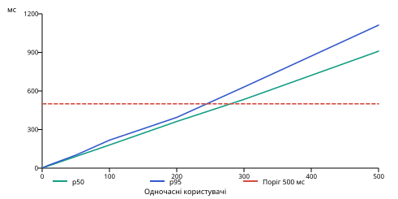

# Продуктивність: фактичні вимірювання

| Режим | Користувачі | p50, мс | p95, мс | Помилки / спроби |
|---|---:|---:|---:|---:|
| baseline | 1 | 33.33 | 39.334 | 0/88 |
| baseline | 10 | 2555.763 | 2657.585 | 0/20 |
| baseline | 50 | 10971.984 | 13827.748 | 0/50 |
| baseline | 100 | 20263.21 | 20485.782 | 80/100 |
| baseline | 200 | 20805.533 | 20897.32 | 200/200 |
| optimized | 1 | 2.8 | 3.231 | 0/1056 |
| optimized | 10 | 19.008 | 23.353 | 0/1571 |
| optimized | 50 | 90.358 | 101.207 | 0/1655 |
| optimized | 100 | 179.934 | 217.53 | 0/1656 |
| optimized | 200 | 362.842 | 394.557 | 0/1690 |
| optimized | 300 | 534.414 | 630.933 | 0/1742 |
| optimized | 500 | 909.176 | 1111.889 | 0/1764 |

Окремий gate: p95 261.852 мс, 1461 відповідей, 0 помилок. Функціональних тестів: 85; domain line coverage: 100%.

На 20 000 рядках optimized: p95 217.530 мс /100 users і 394.557 мс /200 users; перший виміряний вихід за 500 мс — 300 users (630.933 мс). Межа лежить між 200 і 300 у цьому короткому досліді. Baseline перевищує поріг уже на 10 users; 100/200 мають timeout, не є успішними відповідями.

